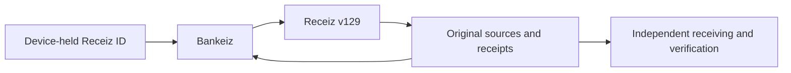

# Reality-Grade Banking

**An open banking architecture for the proof-native economy.**

[](https://github.com/kojibai/reality-grade-banking/actions/workflows/verify.yml)
[](LICENSE)
[](package.json)

Reality-Grade Banking is an open banking architecture and receiving standard for money
and assets that preserve their proof, ownership and history as they move.
This repository brings the working implementation, published requirements,
independent verification tools, matching native sources and integration
materials together in one inspectable foundation.

**Receiz provides the underlying proof infrastructure. Bankeiz is the live
branded reference implementation of Reality-Grade Banking.**
It brings money, assets and their evidence into one account: send and receive
payments, carry funded Notes, own and exchange supported assets, and follow a
transaction back to its sources. It is a complete product and a working
implementation of the shared architecture.

People can use Bankeiz. Builders and institutions can inspect the implementation,
reproduce its checks and operate their own authorized integrations under the
published requirements. The architecture is not limited to one brand or operator.

**The payment moves. Its proof stays connected.**

[Open Bankeiz](https://bankeiz.com/) ·
[Explore assets](https://bankeiz.com/explore/) ·
[Public Ledger](https://bankeiz.com/ledger/) ·
[Understand the economy](https://bankeiz.com/learn/proof-native-economy/) ·
[Build a receiver](institution/README.md) ·
[Documentation map](docs/README.md) ·
[Run locally](#run-locally)

## What this opens up

| For | The practical result |
| --- | --- |
| People and families | One place for money, assets, payments and a history they can inspect. |
| Businesses | Receive money, pay people and suppliers, and keep the supporting transaction records connected. |
| Independent professionals | Share a receiving destination and retain a clear payment record alongside the work. |
| Creators and asset owners | Publish an original, show its supported ownership and history, and use the available ownership actions. |
| Communities and nonprofits | Connect contributions and subsequent payments to inspectable records and their source basis. |
| Institutions and public-sector teams | Integrate receiving and verification against explicit contracts, exact sources and reproducible assessments. |
| Platforms and developers | Build a distinct experience over existing Receiz capabilities instead of inventing another financial writer. |

A supported transaction carries more than a displayed amount: its participants,
exact units, source relationships, authorization and result remain inspectable.
An independent receiver can work from the original evidence rather than relying
on a screenshot or another application's interpretation.

## The product

- **One account.** Device-held Receiz ID opens the existing account. Everyday
  Send and Receive use one amount; funding details stay available underneath.
- **Payments with history.** Find a recipient, review the amount, approve the
  payment and retain its receipt. Sent and received activity remain distinct.
- **Funded Notes.** Create from the available account, save the original and
  hand it to its addressed recipient. Funding is selected automatically.
- **Assets with continuity.** Discover public originals, inspect their media
  and proof back, follow ownership history and use supported Buy ownership or
  Take cash actions. Each public asset has its own shareable page.
- **Conversations and assistance.** Existing Receiz messages, groups and calls
  stay connected to the same ID. Assistant access follows the account's actual
  entitlement; consequential actions retain their own approval.
- **An inspectable economy.** Public assets, valuation methods, the Ledger,
  original receipts and source-of-funds views make the supporting evidence
  available at the appropriate disclosure boundary.
- **A retained PWA.** Encrypted private retention, exact pending-operation
  recovery and retained public navigation preserve continuity across ordinary
  use. Background synchronization adds new supported information.

These are presentations and compositions of Receiz capabilities. Bankeiz does
not create a second account balance, identity authority, messaging service or
financial execution system.

## Open implementation. Independent verification.

The open-source package is part of the product:

| Material | Purpose |
| --- | --- |
| [Application source](src/) | Inspect the actual account, Market, Ledger, messaging and Note experience. |
| [Receiving standard](institution/receiving-standard.md) | Identify the requirements for preserving verification, ownership, value and history. |
| [Receiver kit](institution/README.md) | Run read-only inspection and build an independently assessed receiving integration. |
| [Original schemas](https://bankeiz.com/schemas/) | Inspect the pinned Receiz formats and download their exact definitions. |
| [Matching native source](native/README.md) | Rebuild the included native/verifier modules and inspect their provenance. |
| [Source distribution](SOURCE.md) | Reproduce the content-addressed source archive shipped with each build. |
| [Conformance workspace](https://bankeiz.com/conformance/) | Run the supported local checks and inspect the assessment requirements. |

The original application and documentation are **GPL-3.0-only**. Recipients can
study, modify, deploy and redistribute them under that license. Independent
operators use their own branding, registered application, permissions and
qualified execution. The [software license](LICENSE),
[trademark policy](TRADEMARKS.md) and
[conformance-claim policy](CONFORMANCE.md) describe separate rights and
responsibilities.

## One balance. Exact value underneath.

Settlement preserves proof-native value in exact Phi units. Reserve preserves
proof-backed funds and their admitted denomination. The account presents the
supported total together; automatic funding uses available Reserve first and
Settlement for the remainder.

| Funded Note | What the original retains |
| --- | --- |
| Reserve Note | Its admitted funded denomination and exact backing. |
| Settlement Note | Its exact Phi amount; the dollar presentation follows the supported deterministic rate. |
| Settlement Reserve Note | Both signed funding components and their exact split—Proof-backed Native value. |

The application never asks the user to choose a rail for an ordinary payment or
Note. Original receipts preserve the composition for anyone who needs the detail.

A valuation, available balance, executed price and backing are distinct facts.
Charts use their stated source and method. Where pooled funding is explained
through FIFO, it is **calculated attribution** from the oldest supported
available source; it does not rewrite the allocation recorded by the original
transfer.

Read the [valuation method](https://bankeiz.com/learn/how-value-works/),
[Note contract](docs/connected-notes-v129.md) and
[source-of-funds guide](https://bankeiz.com/learn/source-of-funds/).

## Notes and connectivity

The user flow is Create, Receive and Deposit. The execution path supplies the
required authority:

| Situation | Execution boundary |
| --- | --- |
| Connected creation | Existing account authorization and once-only connected funding. Offline-custody enrollment is not required. |
| Offline receipt | Verify and retain the complete, addressed original on the receiving device. Account credit reconciles on connection before it funds another payment or Note. |
| Continuous offline creation and onward transfer | Requires the qualified protected custody, prepared resources and exact-head irreversible consumption defined by the native contract. |

A copied image does not create additional money. Unknown outcomes retain the
same signed intent and recover its existing result before another financial
attempt. A confirmed repeated deposit is identified explicitly.

The [continuity standard](docs/note-continuity-standard.md) defines the complete
state and evidence model. The [device check](https://bankeiz.com/conformance/#device-evidence)
measures the actual supplied browser/device evidence; it does not grant
qualification by label or weaken antirollback.

## Architecture



The SDK, MCP server and AI Skills are pinned together at **129.0.0**. The active
registry bindings and digests are recorded in
[receiver-profile.json](institution/receiver-profile.json).

| Boundary | Implementation |
| --- | --- |
| Account and retained navigation | [App](src/App.tsx), [core](src/core/), [components](src/components/) |
| Identity and account-source admission | [native identity](src/receiz/native-identity.ts), [native source](src/receiz/bank-native-source.ts) |
| Payments and recovery | [Wallet Send](src/receiz/wallet-send.ts), [payment contract](docs/native-payment-api.md) |
| Notes and exact source retention | [Note runtime](src/receiz/offline-notes.ts), [connected composition](src/receiz/connected-note-application.ts) |
| Public assets and discovery | [public explorer](src/public-explorer/), [Market](src/features/market/) |
| Account and public activity | [Ledger](src/features/ledger/), [public Ledger](src/public-ledger/) |
| Receiz conversations and calls | [messaging interface](src/features/messages/), [native calls](src/receiz/native-calls.ts) |
| Fixed-origin host transport | [server](server/), [API entry](api/index.ts), [routing](vercel.json) |
| Native provenance and distribution | [native sources](native/), [source archive](SOURCE.md) |
| Independent receiving | [institution kit](institution/), [Conformance](src/conformance/) |

Original proof and native admission govern ownership, value and execution.
Databases, APIs, synchronized projections and interface state remain beneath
that authority. Selected-source refusal cannot silently switch to a weaker
financial source. Private keys, phrases, account openings and grant bearers
never belong in public configuration, logs, model context or source exports.

## Run locally

Requires **Node.js 24** and npm, matching the complete CI and native-source
verification environment.

```sh
npm ci
npm run dev -- --host 127.0.0.1
```

Open `http://127.0.0.1:5173`.

For the production PWA:

```sh
npm run build
npm run preview -- --host 127.0.0.1 --port 4173 --strictPort
```

Open `http://127.0.0.1:4173` and use the browser's Install or Add to Home Screen
action. Initial installation needs connectivity. The complete offline inventory
is hash-checked before caching. Financial APIs and private account storage are
excluded from the public service-worker cache.

An open tab retains its build while an update waits. Ordinary activation
preserves encrypted identity custody, originals, receipts and pending operations;
it does not clear account data or force a reload.

## Verify the implementation

```sh
npm run release:check
npm test
npm run typecheck
npm run receiver:check
npm run native:check
npm run native:rebuild -- --sdk
npm run build
npm run source:verify -- --rebuild
```

The [CI workflow](.github/workflows/verify.yml) runs this verification sequence.
The production build also checks public metadata, routing, licensing, source
distribution and the complete offline shell.

To inspect an original Note without performing a financial action:

```sh
npm run receiver:inspect -- /absolute/path/to/original-note.png
```

Inspection verifies its supported carried evidence. Custody, current
spendability and account credit require their corresponding native operations.

## Integrate and operate

Start with [the receiver kit](institution/README.md),
[the developer guide](https://bankeiz.com/developers/) and
[the public schema reference](docs/public-sdk-schemas.md). Reuse the supported
Receiz operation for the action; bind the actual account, recipient, amount,
source and recovery coordinate throughout.

Deploy the application with `npm ci`, `npm run build` and output directory
`dist`. The official application origin is **https://bankeiz.com**.
[Vercel routing](vercel.json) sends the approved Bank transport to its fixed
Receiz host. The frontend requires no Receiz root signing key or Bank client
secret. Another operator must register and authorize its own integration;
cloning source does not copy the official application's service permissions.

See the [origin contract](docs/bankeiz-origin-activation.md),
[operating boundaries](SECURITY.md),
[release process](docs/release-process.md) and
[qualification requirements](institution/qualification.md).

## Release evidence

**[Version 1.0.0 is published](https://github.com/kojibai/reality-grade-banking/releases/tag/v1.0.0)**,
released October 20, 2026 from commit `2231301`.
The [full release notes](docs/releases/1.0.0.md) describe its scope; the
[qualification record](docs/releases/1.0.0-qualification.md) preserves the
source, verification and capability-specific assessment evidence. Versioned
source, actual deployment and publication remain distinct records.

[Current capabilities](docs/current-function-boundaries.md) distinguish
implemented connections from their deployed assessment. Dated
[verification records](docs/verification/) identify the exact commands, sources,
builds and tested scope. Synthetic proof/writer checks, browser lifecycle
checks and real-device financial qualification remain separately identified.

The reviewed Note migrations are
[installed and recorded](docs/verification/2026-10-20-production-note-migrations.md).
Actual deployed funding, receipt delivery, once-only recovery and physical-device
custody are assessed against the selected host and exact release candidate.
Displayed specimen Notes are unissued illustrations.

## Project stewardship

[Contributing](CONTRIBUTING.md) ·
[Governance](GOVERNANCE.md) ·
[Security reporting](SECURITY.md) ·
[Conformance claims](CONFORMANCE.md) ·
[License and notices](LICENSING.md)

Copyright © 2026 **Brian Joseph Klock (BJ Klock)**.
Bankeiz.com is the official reference implementation. Preserve applicable
[third-party notices](THIRD_PARTY_NOTICES.md) and the complete corresponding
source required for covered distributions.
